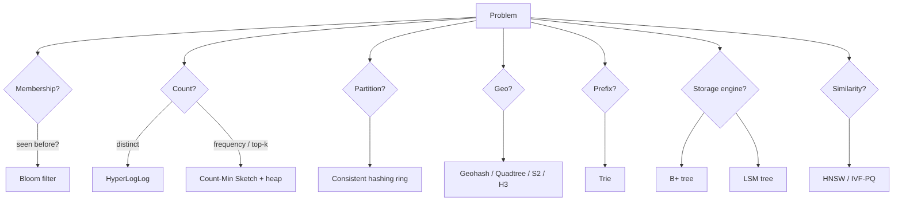

# Data Structures That Show Up in System Design

## 1. Bloom Filter
- **What:** bit array + k hash functions. Insert sets k bits; query checks k bits.
- **Guarantee:** no false negatives; false positives with probability ≈ `(1 − e^(−kn/m))^k`.
- **Sizing:** `m = −n·ln(p) / (ln 2)²` bits; `k = (m/n)·ln 2`. ~10 bits/element → 1% FP.
- **Uses:** avoid disk lookups for absent keys (LSM SSTables, Cassandra), web crawler "URL seen?", cache penetration protection, username-taken check, recommend "not already shown".
- **Limits:** can't delete (use counting Bloom filter or Cuckoo filter).

## 2. HyperLogLog
- **What:** estimates cardinality (distinct count) using the max number of leading zeros of hashed values across many registers.
- **Accuracy:** ~1.04/√m. With 16K registers (12 KB) → ~0.8% error, for billions of items.
- **Mergeable:** union of HLLs = register-wise max → distributed counting of unique users per day/region.
- **Uses:** unique visitors, distinct search queries. Redis `PFADD`/`PFCOUNT`.

## 3. Count-Min Sketch
- **What:** d rows × w columns of counters, one hash per row. Increment one counter per row; estimate = min across rows.
- **Guarantee:** overestimates only; error ≤ εN with prob 1−δ, w = e/ε, d = ln(1/δ).
- **Uses:** heavy hitters / Top-K (combine with min-heap of size K), frequency of hot keys, rate limiting at huge cardinality.

## 4. Consistent Hashing
- **What:** hash nodes and keys onto a ring; key goes to next node clockwise. Adding/removing a node moves only ~1/N keys.
- **Virtual nodes:** each physical node gets 100–200 points on the ring → even load and smooth rebalancing; weighted by capacity.
- **Alternatives:** rendezvous (HRW) hashing — score each node by hash(key, node), pick max; jump consistent hash (no memory, buckets numbered only).
- **Uses:** distributed caches, Cassandra/Dynamo partitioning, sharded rate limiters, sticky LB, KV-cache-aware LLM routing.

## 5. Geospatial Indexes
| Index | Idea | Pros | Cons |
|---|---|---|---|
| **Geohash** | Interleave lat/long bits → base32 string; prefix = cell | Simple, works in any KV/B-tree with prefix scan | Edge problems (neighbors with different prefix) → query 9 cells |
| **Quadtree** | Recursively split cells with >N points into 4 | Adapts to density | In-memory, rebalancing on updates |
| **S2 (Google)** | Hilbert curve on cube faces → 64-bit cell IDs | Great locality, region covering | More complex |
| **H3 (Uber)** | Hexagonal hierarchical grid | Uniform neighbor distance, good for surge/ETA | Not perfectly nested |
| **R-tree** | Bounding-rectangle tree | Polygons, ranges (PostGIS) | Write-heavy updates slow |

Uses: nearby drivers, Yelp/restaurants, geofencing. Rule: static places → quadtree/geohash in DB; fast-moving drivers → in-memory geohash buckets in Redis (`GEOADD`/`GEOSEARCH`) updated every few seconds.

## 6. Trie (Prefix Tree)
- Each node = character; path = prefix. Store top-K completions at each node to make autocomplete O(prefix length).
- Memory heavy → compress (radix tree), shard by prefix, or replace with precomputed prefix→top-K map in Redis.

## 7. B+ Tree vs LSM Tree

| | B+ tree | LSM tree |
|---|---|---|
| Write path | In-place page updates + WAL | Append to WAL + memtable → flush to immutable SSTables |
| Read | O(log n), 1 lookup | Check memtable + multiple SSTables (Bloom filters help) |
| Write amplification | Moderate | Compaction rewrites data |
| Best for | Read-heavy, range scans | Write-heavy ingestion |
| Used in | Postgres, MySQL InnoDB | Cassandra, RocksDB, LevelDB, HBase, ScyllaDB |

Compaction strategies: size-tiered (write-optimized), leveled (read-optimized), time-window (TTL'd time series).

## 8. Skip List
- Probabilistic layered linked list, O(log n) search/insert, easy concurrency.
- **Redis sorted sets** = skip list + hash map → leaderboards (`ZADD`, `ZREVRANGE`, `ZRANK` in O(log n)).

## 9. Merkle Tree
- Tree of hashes; root summarizes all data. Two replicas compare roots, descend only into differing subtrees.
- Uses: anti-entropy repair in Dynamo/Cassandra, Git, blockchains, file sync (Dropbox-like), certificate transparency.

## 10. Inverted Index
- term → posting list of (docID, positions, tf). Intersect posting lists for AND queries; score with BM25.
- Uses: Elasticsearch, search engines, log search.

## 11. Ring Buffer / Circular Queue
- Fixed-size, overwrite-oldest. Uses: in-memory logs, sliding window metrics, LMAX disruptor, audio buffers.

## 12. Heaps and Top-K
- Min-heap of size K for streaming Top-K: O(n log K).
- Distributed Top-K: local heaps per partition → merge (exact only if each partition's keys are disjoint; otherwise use count aggregation first).

## 13. Vector Indexes (ANN)
| Index | Idea | Tradeoff |
|---|---|---|
| **Flat** | Brute-force | Exact, O(n) — fine < ~100K vectors |
| **IVF** | k-means clusters; search nprobe nearest clusters | Fast, recall depends on nprobe |
| **PQ** | Compress vectors into sub-vector codebook IDs | 10–50× memory reduction, lower recall |
| **HNSW** | Multi-layer proximity graph, greedy search | Best recall/latency, memory-heavy, slow builds |
| **DiskANN** | Graph on SSD | Billion-scale on one node |

Parameters to mention: HNSW `M`, `efConstruction`, `efSearch`; IVF `nlist`, `nprobe`. Deep dive: [`08-embedding-pipeline-design.md`](../../../13-production-ml/08-embedding-pipeline-design.md).

## 14. Snowflake ID / ULID
- 64-bit: 41 bits ms timestamp + 10 bits machine + 12 bits sequence → 4096 IDs/ms/machine, time-sortable.

## 15. Quick Map: Problem → Structure

| Problem | Structure |
|---|---|
| Has user seen this URL/item? | Bloom filter |
| Unique visitors per day | HyperLogLog |
| Trending hashtags / heavy hitters | Count-Min Sketch + heap |
| Leaderboard | Redis sorted set (skip list) |
| Shard keys across cache nodes | Consistent hashing |
| Nearby drivers | Geohash buckets / H3 |
| Autocomplete | Trie with cached top-K |
| Replica diff | Merkle tree |
| Rate limit counters | Hash map + sliding window / token bucket |
| Semantic search | HNSW / IVF-PQ |
| Ordered, sortable IDs | Snowflake / ULID |
