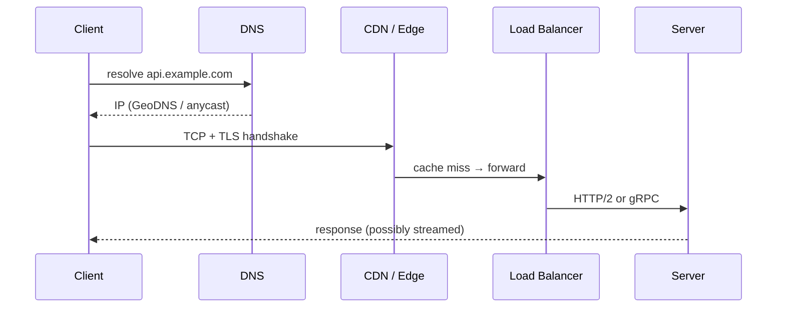

# Networking for System Design

## 1. The Layers That Matter

| OSI layer | Protocols | Why you care in interviews |
|---|---|---|
| L7 Application | HTTP/1.1, HTTP/2, HTTP/3, gRPC, WebSocket, DNS, SMTP | API design, L7 LB, caching headers |
| L4 Transport | TCP, UDP, QUIC | Reliability vs latency; L4 LB |
| L3 Network | IP, BGP, anycast | Routing, multi-region, DDoS |

## 2. TCP vs UDP vs QUIC

| | TCP | UDP | QUIC (HTTP/3) |
|---|---|---|---|
| Connection | 3-way handshake (1 RTT) + TLS (1 RTT in 1.3) | None | 1 RTT combined, 0-RTT resumption |
| Reliability | Ordered, retransmits | None | Per-stream reliable |
| Head-of-line blocking | Yes (one lost packet stalls all) | No | No across streams |
| Use | APIs, DBs, most things | Video calls, games, DNS, metrics | Mobile, lossy networks |

**Key insight:** connection setup is expensive (RTTs). Reuse connections (keep-alive, pooling, HTTP/2 multiplexing).

## 3. HTTP Versions

- **HTTP/1.1:** one request at a time per connection (pipelining unused) → browsers open ~6 connections/host.
- **HTTP/2:** binary framing, multiplexed streams on one TCP connection, header compression (HPACK), server push (deprecated). Still TCP HOL blocking.
- **HTTP/3:** over QUIC (UDP); no TCP HOL; connection migration (wifi → cellular).

**Status codes to use correctly:** 200, 201 Created, 202 Accepted (async), 204, 301/302/307/308, 304 Not Modified, 400, 401 (unauthenticated), 403 (unauthorized), 404, 409 Conflict, 412 Precondition Failed (ETag mismatch), 422, 429 Too Many Requests, 500, 502, 503 (+Retry-After), 504.

## 4. Real-Time Communication Options

| Method | Direction | Mechanism | Use |
|---|---|---|---|
| Short polling | C→S | Request every N sec | Rarely changing, simple |
| Long polling | C→S, held open | Server responds when data or timeout | Fallback for real-time; moderate scale |
| **SSE** (Server-Sent Events) | S→C | One HTTP response, `text/event-stream`, auto-reconnect with `Last-Event-ID` | **LLM token streaming**, live scores, notifications |
| **WebSocket** | Bidirectional | HTTP Upgrade → persistent full-duplex frame channel | Chat, collaborative editing, games |
| WebRTC | Peer-to-peer (UDP) | ICE/STUN/TURN for NAT traversal | Video/voice calls |
| gRPC streaming | Uni/bi-directional | HTTP/2 streams | Service-to-service streaming (inference servers) |

**Scaling WebSockets:** connections are stateful → need a connection registry (user → gateway server) in Redis, sticky LB, and pub/sub between gateways. ~100K–1M concurrent conns per tuned server (file descriptors, memory ~10–50KB/conn).

**Why ChatGPT-style apps use SSE:** one-directional token stream, plain HTTP (works through proxies/CDNs), auto-reconnect, simple. WebSockets only when the client needs to send mid-stream (voice, interruption).

## 5. DNS

- Resolution: stub → recursive resolver → root → TLD → authoritative. Cached at each layer per TTL.
- Record types: A, AAAA, CNAME, MX, TXT, NS, SRV.
- **GeoDNS / latency routing:** return region nearest to user.
- **Failover:** health-checked DNS (Route 53). Low TTL (30–60s) = faster failover but more queries; clients/resolvers may ignore TTL.

## 6. Load Balancers

| | L4 | L7 |
|---|---|---|
| Sees | IP/port | HTTP headers, paths, cookies |
| Speed | Very fast | Slower (parse, TLS) |
| Features | — | Path routing, TLS termination, retries, rate limiting, auth, canary |
| Examples | AWS NLB, LVS, Maglev | ALB, Nginx, Envoy, HAProxy |

Topology: DNS → global LB (anycast) → regional L4 → L7 → services. LBs themselves are made HA via active-passive pairs with VRRP or anycast/ECMP.

## 7. CDN

- **Pull CDN:** edge fetches from origin on miss, caches per `Cache-Control`. Easy; first request slow.
- **Push CDN:** you upload content to the CDN ahead of time. Good for large, predictable assets (video).
- **Cache keys** include URL + selected headers. Avoid cookies in cache key.
- **Invalidation:** versioned URLs (`app.v123.js`) beats purge APIs.
- **Origin shield:** a mid-tier cache to collapse misses from many edges.
- **Edge compute:** Cloudflare Workers / Lambda@Edge for auth, A/B, personalization.
- **Signed URLs:** time-limited access to private content.

## 8. Proxies and Gateways

- **Forward proxy:** client-side (corporate egress).
- **Reverse proxy:** server-side (Nginx, Envoy) — TLS, caching, compression, LB.
- **API gateway:** reverse proxy + auth, rate limiting, request transformation, API keys, routing to microservices. For LLMs → **AI gateway** (token-aware limits, model routing, fallbacks).
- **Service mesh** (Istio/Linkerd): sidecar proxies for mTLS, retries, observability between services.

## 9. Latency Numbers

| Operation | Time |
|---|---|
| L1 cache ref | 0.5 ns |
| Main memory ref | 100 ns |
| Read 1 MB sequential from memory | ~3 µs |
| SSD random read | ~16–100 µs |
| Read 1 MB sequential from SSD | ~50 µs–1 ms |
| Round trip within datacenter | 0.5 ms |
| Read 1 MB from network (10 Gbps) | ~1 ms |
| Disk seek (HDD) | 2–10 ms |
| Round trip same continent | 20–50 ms |
| Round trip US↔Europe | ~80–150 ms |
| TLS handshake (cold) | 1–2 RTT |
| LLM TTFT (API, short prompt) | 200–800 ms |
| LLM per-output token | 10–50 ms |

**Takeaway:** a cross-region call costs ~100× an in-DC call. An LLM call costs ~1000× a cache hit.

## 10. Common Interview Questions

- *Why is WebSocket harder to scale than HTTP?* Stateful long-lived connections; LB can't freely rebalance; deploys must drain; need cross-server pub/sub.
- *How do you push a message to a user connected to a different server?* Registry (user→server) + pub/sub (Redis/Kafka) or direct RPC to that gateway.
- *How would you reduce latency for global users?* CDN for static, multi-region read replicas/edge, anycast, connection reuse, HTTP/3.
- *How does SSE handle a dropped connection mid-LLM-stream?* Client reconnects with `Last-Event-ID`; server either resumes from a buffered stream (stored by message ID in Redis) or regenerates. Most products just store the final message and let the UI refetch.
