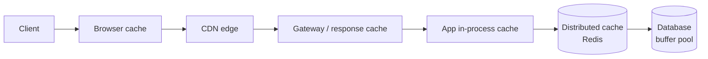

# Caching

Caching trades **freshness and complexity** for **latency and load reduction**. Always answer: *what's cached, where, how is it invalidated, what happens on a miss, and what's the hit rate?*

## 1. Where to Cache

| Layer | Examples | Latency | Notes |
|---|---|---|---|
| Client | Browser, mobile, HTTP cache | 0 | `Cache-Control`, `ETag` |
| CDN | CloudFront, Akamai | ~10–50 ms | Static + cacheable API responses |
| Gateway/reverse proxy | Nginx, Varnish | ~1 ms | Whole responses |
| In-process | Guava, Caffeine, LRU dict | ~µs | Fastest; not shared; inconsistent across instances |
| Distributed | Redis, Memcached | ~0.5–1 ms | Shared, scalable |
| DB | Buffer pool, query cache, materialized views | — | Automatic |
| **AI-specific** | Prompt/prefix (KV) cache, semantic cache, embedding cache | varies | See §8 |

## 2. Read/Write Strategies

| Strategy | Read path | Write path | Pros | Cons |
|---|---|---|---|---|
| **Cache-aside** (lazy) | App checks cache → miss → DB → populate | App writes DB, **deletes** cache key | Simple, cache only what's used | Miss penalty, race-induced staleness |
| **Read-through** | Cache loads from DB on miss | — | App simpler | Cache needs DB loader |
| **Write-through** | — | Write cache + DB synchronously | Cache always fresh | Write latency; caches unread data |
| **Write-back / write-behind** | — | Write cache, flush to DB async | Very fast writes, batching | Data loss on cache failure |
| **Write-around** | — | Write DB only | Avoids polluting cache | First read misses |
| **Refresh-ahead** | Proactively refresh before TTL | — | No miss latency for hot keys | Wasted refreshes |

**Default:** cache-aside with **delete-on-write** (not update-on-write — two concurrent updates can leave the cache with the older value).

## 3. Invalidation

"There are only two hard things…" Options:
1. **TTL** — bounds staleness. Always set one, even with explicit invalidation (safety net). Add jitter to avoid synchronized expiry.
2. **Explicit delete on write** — app deletes after DB commit.
3. **CDC-driven invalidation** — Debezium reads DB binlog → Kafka → invalidator deletes keys. Decouples and catches all writers.
4. **Versioned keys** — `user:123:v7`; bump version on write; old keys age out.
5. **Lease / delayed double delete** — delete, write DB, sleep briefly, delete again (handles read-repopulates-stale race).

**Facebook memcache lease trick:** on miss, cache issues a lease token; only the lease holder may set; a delete invalidates the lease → prevents stale sets and thundering herds.

## 4. Eviction Policies

| Policy | Evicts | Good for |
|---|---|---|
| LRU | Least recently used | General default |
| LFU | Least frequently used | Stable popularity skew |
| FIFO | Oldest inserted | Simple |
| TTL | Expired | Freshness-bounded |
| W-TinyLFU (Caffeine) | Admission filter + LRU | Best-in-class hit rates |
| Random | Random | Cheap, surprisingly OK |

Redis: `allkeys-lru`, `volatile-lru`, `allkeys-lfu`, etc.

## 5. Failure Modes and Fixes

| Problem | What happens | Fix |
|---|---|---|
| **Cache stampede / thundering herd** | Hot key expires → thousands of requests hit DB simultaneously | Request coalescing (single-flight), lock/lease on rebuild, probabilistic early expiration, stale-while-revalidate |
| **Cache penetration** | Queries for non-existent keys always miss → DB hammered (often malicious) | Cache negative results (short TTL), Bloom filter of valid keys |
| **Cache avalanche** | Many keys expire at once or cache cluster dies | TTL jitter, multi-level caches, circuit breaker to DB, pre-warm |
| **Hot key** | One key overloads one cache shard | Local in-process cache, key replication (`key#1..N` random suffix), read replicas |
| **Big key** | 10MB value blocks Redis single thread | Split, compress, store in S3 with pointer |
| **Inconsistency** | Cache and DB diverge | Delete-on-write + TTL + CDC; accept bounded staleness |
| **Cold start** | Empty cache after deploy/failure | Warm from logs of top keys; gradual traffic shift |

## 6. Distributed Cache Topology

- **Sharding:** consistent hashing (client-side like twemproxy/mcrouter, or Redis Cluster's 16384 hash slots).
- **Replication:** primary-replica per shard for HA; reads from replicas can be stale.
- **Sizing:** working set × overhead (~1.5–2× for Redis). Target 80–99% hit rate; hit rate drives DB size.
- **Effective latency:** `hit_rate × cache_latency + (1−hit_rate) × db_latency`. At 95% hit, 1ms cache, 20ms DB → ~2ms.

## 7. HTTP Caching

- `Cache-Control: public, max-age=3600, s-maxage=86400, stale-while-revalidate=60`
- `ETag` + `If-None-Match` → `304 Not Modified`
- `Vary: Accept-Encoding` — be careful varying on cookies/auth.
- Private data: `Cache-Control: private` (browser only) or `no-store`.

## 8. Caching in AI Systems

| Cache | Key | Value | Hit rate driver | Gotchas |
|---|---|---|---|---|
| **Exact prompt cache** | hash(model, params, full prompt) | Completion | Repeated identical requests (evals, FAQ bots) | Useless with temperature > 0 if you want diversity |
| **Provider prompt caching** (Anthropic/OpenAI) | Prompt prefix | Cached KV on provider side | Stable system prompt + tools + docs at the start | Order matters: put static content first; ~5-min to 1-hr TTL; up to ~90% discount on cached input tokens |
| **Prefix / KV cache** (self-hosted: vLLM APC, SGLang RadixAttention) | Token prefix blocks | GPU KV blocks | Shared system prompts, multi-turn chats | Needs cache-aware routing to land on same replica |
| **Semantic cache** | Embedding of query → ANN lookup with similarity threshold | Prior answer | Paraphrased repeat intents (support bots) | False hits ("cancel order" ≈ "don't cancel order"); scope per tenant/user; threshold tuning; staleness |
| **Embedding cache** | hash(text, model) | Vector | Re-embedding same chunks/queries | Invalidate on model change |
| **Retrieval cache** | normalized query | Top-K doc IDs | Popular queries | Invalidate on index update |
| **Tool-result cache** | tool + args | Result | Agents repeatedly calling same API | Respect data freshness/permissions |

**Design rule for LLM apps:** structure prompts as `[static system] [tools] [static docs] [conversation history] [new user turn]` so the cacheable prefix is maximal.

## 9. Interview Checklist

- [ ] What's the read/write ratio? (Caching helps read-heavy.)
- [ ] What's the acceptable staleness?
- [ ] Which strategy (cache-aside default) and invalidation (delete + TTL)?
- [ ] How big is the working set? Memory cost?
- [ ] Stampede/hot key/penetration handling?
- [ ] What happens when the cache is down? (DB must survive or shed load.)
