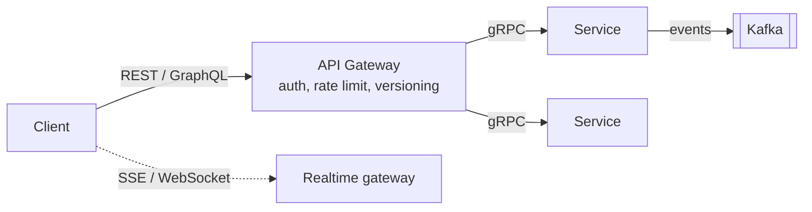

# API Design



In the interview, spend ~5 minutes: list core endpoints that cover every functional requirement, with request/response shapes and key params. Don't enumerate CRUD for everything.

## 1. Styles

| | REST | gRPC | GraphQL |
|---|---|---|---|
| Transport | HTTP/1.1 or 2, JSON | HTTP/2, Protobuf | HTTP, JSON |
| Contract | OpenAPI (optional) | `.proto` (strict) | Schema (strict) |
| Strength | Simple, cacheable, universal | Fast, typed, streaming, codegen | Client picks fields, one round trip for nested data |
| Weakness | Over/under-fetching, chatty | Browser support (needs grpc-web), less human-readable | Caching hard, N+1 resolvers, query cost control |
| Use | Public APIs | Internal service-to-service, inference servers | Mobile/web BFF with varied views |

Others: **WebSocket/SSE** for real-time, **webhooks** for server→server callbacks, **async job APIs** (202 + poll/callback).

## 2. REST Resource Design

```
POST   /v1/users                       create
GET    /v1/users/{id}                  read
PATCH  /v1/users/{id}                  partial update
DELETE /v1/users/{id}
GET    /v1/users/{id}/posts?cursor=…&limit=20
POST   /v1/posts/{id}/likes            sub-resource action
POST   /v1/orders/{id}:cancel          custom verb (Google AIP style)
```

- Nouns, plural, hierarchical. Verbs = HTTP methods.
- **Safe:** GET, HEAD. **Idempotent:** GET, PUT, DELETE. **Not idempotent:** POST, PATCH (unless engineered).
- Return created resource + `Location` header on 201.

## 3. Pagination

| Type | How | Pros | Cons |
|---|---|---|---|
| Offset | `?offset=40&limit=20` | Simple, jump to page | O(offset) DB scan; shifting results on insert |
| **Cursor / keyset** | `?cursor=<opaque base64 of (created_at,id)>` → `WHERE (created_at,id) < (…) ORDER BY … LIMIT 20` | Stable, O(1) per page, good for feeds | No random page jump |
| Page token | Server-generated opaque token | Hides implementation | — |

**Default for feeds/timelines: cursor-based.**

## 4. Idempotency

```
POST /v1/payments
Idempotency-Key: 7c1e…-uuid
```
Server:
1. `INSERT INTO idempotency(key, status='in_progress')` — unique constraint; if exists → return stored response (or 409 if still in progress).
2. Process.
3. Store response; TTL 24h–7d.

Critical for payments, order creation, LLM-agent tool calls with side effects.

## 5. Versioning

- URL (`/v1/`) — most common, explicit.
- Header (`Accept: application/vnd.x.v2+json`) — cleaner URLs.
- Rules: additive changes are non-breaking; never remove/rename fields in a version; deprecate with `Sunset` header.
- gRPC/Protobuf: never reuse field numbers.

## 6. Errors

```json
{ "error": { "code": "RATE_LIMITED", "message": "…", "retry_after_ms": 1200, "request_id": "…" } }
```
Consistent shape, machine-readable code, request ID for tracing. 4xx = client fix; 5xx = retryable (maybe).

## 7. Rate Limiting & Quotas in APIs

- Headers: `X-RateLimit-Limit`, `X-RateLimit-Remaining`, `X-RateLimit-Reset`, `Retry-After`.
- Tiers per API key/plan. LLM APIs: **RPM + TPM (tokens per minute)** limits per org/model.

## 8. Async / Long-Running Operations

```
POST /v1/videos:transcode   → 202 Accepted { "operation_id": "op_123" }
GET  /v1/operations/op_123  → { "status": "running", "progress": 0.4 }
                            → { "status": "done", "result_url": "…" }
```
Or webhook callback on completion. Used for: transcoding, batch inference, fine-tuning jobs, report generation.

## 9. Streaming APIs (LLM)

```
POST /v1/chat/completions  { "model": "...", "messages": [...], "stream": true }
→ Content-Type: text/event-stream
data: {"delta":"Hel"}
data: {"delta":"lo"}
data: {"usage":{"input_tokens":12,"output_tokens":2}, "finish_reason":"stop"}
data: [DONE]
```
Design points: usage reported at end, client cancellation must propagate to the GPU (stop generating = save money), tool calls streamed as partial JSON, error mid-stream needs an error event.

## 10. Security

- AuthN: OAuth2 (authorization code + PKCE for apps), client credentials for service-to-service, API keys for developer APIs, JWT for stateless auth (short-lived + refresh tokens).
- AuthZ: check per resource (`user owns post`) — avoid IDOR.
- Input validation, request size limits, CORS, HTTPS only.
- Webhooks: sign payloads (HMAC), include timestamp to prevent replay.

## 11. Batch & Bulk

- `POST /v1/items:batchGet {ids:[…]}` reduces round trips.
- Partial-failure response: per-item status.

## 12. Example: Interview API Spec (Twitter-like)

```
POST /v1/tweets               {text, media_ids[]} → {tweet_id}
GET  /v1/timeline/home?cursor → {tweets[], next_cursor}
GET  /v1/users/{id}/tweets?cursor
POST /v1/users/{id}/follow
POST /v1/tweets/{id}/like
POST /v1/media:upload         → {upload_url (presigned), media_id}
```
Notice: user ID comes from the auth token, not the body. Media upload goes direct to S3 via presigned URL.

## 13. Interview Checklist
- [ ] Endpoints cover every functional requirement
- [ ] Pagination style chosen (cursor for feeds)
- [ ] Idempotency for mutating, retried calls
- [ ] Auth source (token, not body)
- [ ] Large payloads bypass the API (presigned URLs)
- [ ] Long work → async (202)
- [ ] Streaming for real-time / LLM output
