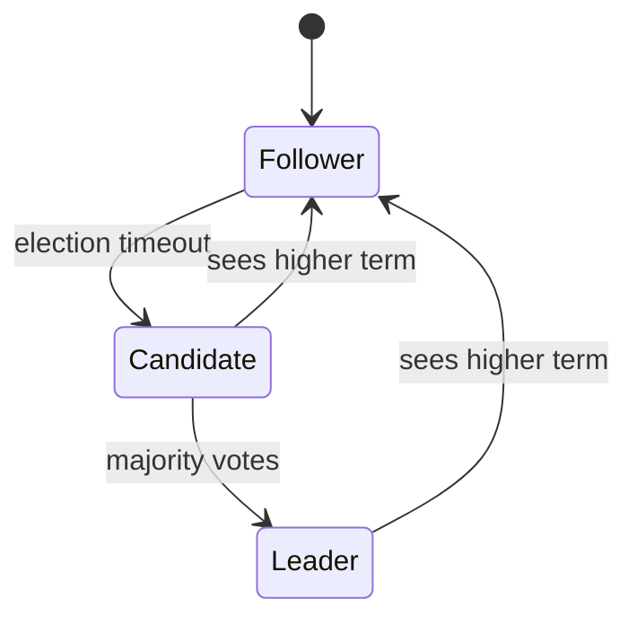

# Distributed Systems

## 1. Fallacies of Distributed Computing
The network is reliable; latency is zero; bandwidth is infinite; the network is secure; topology doesn't change; there is one administrator; transport cost is zero; the network is homogeneous. **Every design must handle partial failure.**

## 2. Failure Models
- **Crash-stop / crash-recovery:** node dies (and maybe restarts).
- **Omission:** messages lost.
- **Timing:** messages delayed arbitrarily — you can't distinguish slow from dead.
- **Byzantine:** arbitrary/malicious behavior (blockchains; rarely in interviews).

**Failure detection:** heartbeats + timeouts; phi-accrual detectors (Cassandra) give suspicion levels; gossip protocols spread membership.

## 3. Time and Ordering
- **Physical clocks drift**; NTP gives ~ms accuracy. Never use wall clocks to order events across nodes.
- **Lamport clocks:** counter incremented on each event, max+1 on receive → total order consistent with causality (but not detecting concurrency).
- **Vector clocks:** per-node counters → detect concurrent writes (Dynamo-style conflict detection).
- **Hybrid Logical Clocks (HLC):** physical + logical; used by CockroachDB.
- **TrueTime (Spanner):** GPS/atomic clocks give bounded uncertainty; commit-wait → external consistency.
- **Fencing tokens:** monotonically increasing token from lock service; storage rejects writes with older tokens → safety even if lock holder pauses (GC).

## 4. Consensus
Agreement among nodes on a value/log despite failures. Needs majority (quorum): tolerate `f` failures with `2f+1` nodes.

**Raft (understandable Paxos):**
1. **Leader election:** followers time out (randomized 150–300ms) → become candidate → request votes → majority = leader for that *term*.
2. **Log replication:** leader appends entry, sends AppendEntries; committed when majority has it; then applied to state machine.
3. **Safety:** a candidate's log must be at least as up-to-date as the voter's → leaders always have all committed entries.

Used in: etcd, Consul, CockroachDB, TiKV, Kafka KRaft. Paxos/Multi-Paxos: Chubby, Spanner. ZAB: ZooKeeper.

**What consensus gives you:** leader election, distributed locks, configuration, membership, atomic broadcast, linearizable KV.

**Cost:** every write needs a majority round trip → not for high-throughput data paths; use for metadata/coordination.

## 5. Quorums (Leaderless)
- N replicas, write to W, read from R. `R + W > N` → read overlaps latest write.
- N=3, W=2, R=2: tolerate 1 failure for both reads and writes.
- W=1, R=N: fast writes, slow reads. W=N, R=1: fast reads, fragile writes.
- **Sloppy quorum + hinted handoff:** write to any healthy N nodes, hand back later — availability over consistency.
- **Read repair & anti-entropy (Merkle trees):** converge replicas.

## 6. Conflict Resolution
- **Last-write-wins (LWW):** simple, loses data on concurrent writes.
- **Vector clocks + app merge:** return siblings to client (shopping cart union).
- **CRDTs:** data types that merge deterministically — G-Counter, PN-Counter, OR-Set, LWW-Register, RGA/sequence CRDTs (collaborative text: Yjs, Automerge).
- **Operational Transformation:** Google Docs approach, central server transforms concurrent ops.

## 7. Leader Election & Distributed Locks
- Use etcd/ZooKeeper leases (ephemeral nodes / TTL leases), not hand-rolled.
- **Redis lock (`SET key val NX PX 30000`)**: fine for efficiency (avoid duplicate work), not for correctness. Redlock is debated — add fencing tokens if correctness matters.
- Lease must be renewed; holder must stop work if it can't renew.

## 8. Distributed Transactions
- **2PC:** coordinator → prepare → all vote yes → commit. Blocking if coordinator dies after prepare. Used within DBs (Spanner uses 2PC over Paxos groups).
- **Sagas:** sequence of local transactions with compensating actions. Orchestrated (central coordinator) or choreographed (events).
- **Outbox pattern:** write business row + event row in one local transaction; relay publishes events → reliable event emission without 2PC.
Details: [Database design](04-database-design.md).

## 9. Partitioning + Replication Together
Typical: data split into partitions (hash ring / ranges), each partition replicated 3× (Raft group or leaderless). Rebalancing moves partitions, not keys. Examples: Kafka (partition leader + ISR), CockroachDB ranges (Raft per range), Cassandra (token ring + RF=3).

## 10. Consistency Patterns in Practice
| Need | Mechanism |
|---|---|
| Unique username | Single-leader DB unique constraint, or consensus |
| Inventory never oversold | Atomic conditional update / serializable txn on one partition |
| Bank transfer across shards | Saga with idempotent steps + ledger, or 2PC in a NewSQL DB |
| Feed eventually consistent | Async fan-out via Kafka |
| Exactly one scheduler running | Leader election via etcd lease |

## 11. Back-of-Envelope Distributed Reasoning
- Majority quorum of 5 across 3 AZs (2-2-1) survives an AZ loss.
- Cross-region Raft → every write ~100ms. Keep consensus groups regional; replicate async across regions unless you truly need global strong consistency.

## 12. Distributed Systems in AI Infra
- **Model weight distribution:** P2P/torrent-style or S3 + local NVMe caching to start replicas fast.
- **Distributed training:** collective comms (all-reduce), checkpointing, elastic recovery — see [`12-systems-and-scale/06`](../../../12-systems-and-scale/06-distributed-training-and-serving-reliability.md).
- **Distributed inference:** tensor/pipeline parallelism across GPUs; prefill/decode disaggregation — see [`20-ai-infrastructure/04`](../../../20-ai-infrastructure/04-parallelism-topology.md).
- **Agent orchestration:** durable execution (Temporal) gives exactly-once workflow semantics with at-least-once activities → tools must be idempotent.
